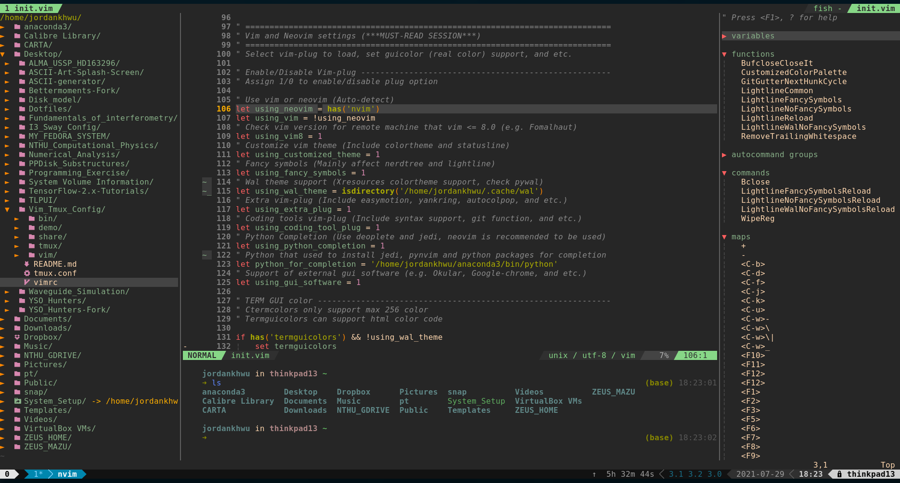
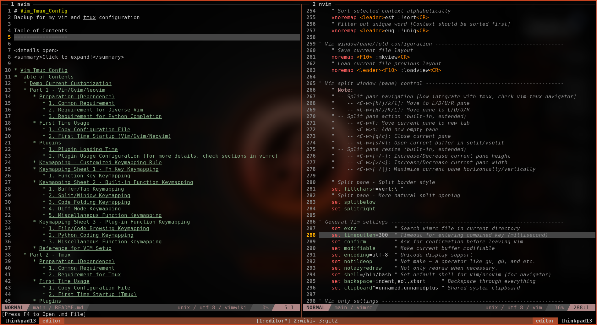
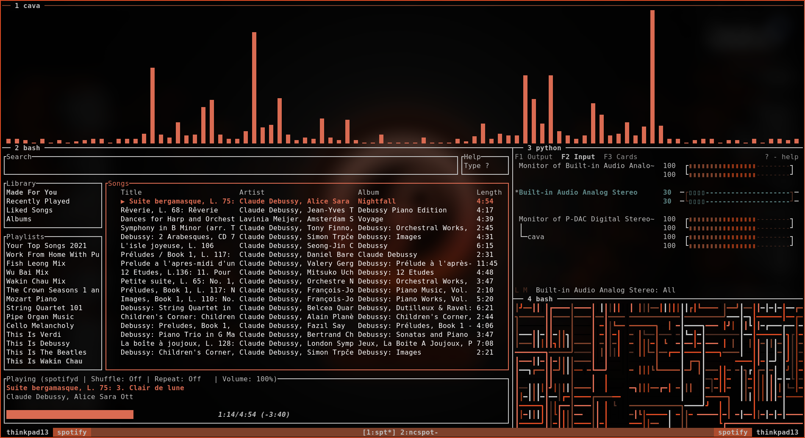

# Vim_Tmux_Config

Backup for my Vim and TMUX configuration

<details open>
<summary>Click to expand!</summary>

# Table of Contents

<details open>
<summary>Click to expand!</summary>

- [Vim_Tmux_Config](#vim_tmux_config)
- [Table of Contents](#table-of-contents)
- [Context](#context)
  - [Demo Current Customization](#demo-current-customization)
  - [Project Structure](#project-structure)
  - [Part 1 - Vim/Gvim/Neovim](#part-1---vimgvimneovim)
    - [Section 1 - What's New in My Customization (Vim)](#section-1---whats-new-in-my-customization-vim)
    - [Section 2 - First Time Usage (Vim)](#section-2---first-time-usage-vim)
      - [1. Preparation for Dependence (Vim)](#1-preparation-for-dependence-vim)
      - [2. Copy Configuration File (Vim)](#2-copy-configuration-file-vim)
      - [3. First Time Startup (Vim)](#3-first-time-startup-vim)
    - [Section 3 - Plugin Usage (Vim)](#section-3---plugin-usage-vim)
      - [1. Plugin Loading Time (Vim)](#1-plugin-loading-time-vim)
      - [2. Plugin Usage Configuration (Vim)](#2-plugin-usage-configuration-vim)
    - [Section 4 - Key Mapping (Vim)](#section-4---key-mapping-vim)
      - [Key Mapping Rule - Customized Key Mapping (Vim)](#key-mapping-rule---customized-key-mapping-vim)
      - [Key Mapping Hinter - Vim Whichkey (Vim)](#key-mapping-hinter---vim-whichkey-vim)
      - [Key Mapping Sheet 1 - Fn-key Key Mapping (Vim)](#key-mapping-sheet-1---fn-key-key-mapping-vim)
        - [1. Fn-key Key Mapping](#1-fn-key-key-mapping)
      - [Key Mapping Sheet 2 - Built-in Function Key Mapping (Vim)](#key-mapping-sheet-2---built-in-function-key-mapping-vim)
        - [1. Arg/Buffer/Tab Key Mapping](#1-argbuffertab-key-mapping)
        - [2. Split/Window Key Mapping](#2-splitwindow-key-mapping)
        - [3. Code Folding Key Mapping](#3-code-folding-key-mapping)
        - [4. Diff Mode Key Mapping](#4-diff-mode-key-mapping)
        - [5. Spell Mode Key Mapping](#5-spell-mode-key-mapping)
        - [6. Quickfix/Location List Key Mapping](#6-quickfixlocation-list-key-mapping)
        - [7. Miscellaneous Function Key Mapping](#7-miscellaneous-function-key-mapping)
      - [Key Mapping Sheet 3 - Plug-in Function Key Mapping (Vim)](#key-mapping-sheet-3---plug-in-function-key-mapping-vim)
        - [1. File/Code Browsing Key Mapping](#1-filecode-browsing-key-mapping)
        - [2. Python Coding Key Mapping](#2-python-coding-key-mapping)
        - [3. Miscellaneous Function Key Mapping](#3-miscellaneous-function-key-mapping)
      - [Key Mapping Sheet 4 - LSP Key Mapping (Vim)](#key-mapping-sheet-4---lsp-key-mapping-vim)
    - [Reference for Setup (Vim)](#reference-for-setup-vim)
  - [Part 2 - TMUX](#part-2---tmux)
    - [Section 1 - What's New in My Customization (TMUX)](#section-1---whats-new-in-my-customization-tmux)
    - [Section 2 - First Time Usage (TMUX)](#section-2---first-time-usage-tmux)
      - [1. Preparation for Dependence (TMUX)](#1-preparation-for-dependence-tmux)
      - [2. Copy Configuration File (TMUX)](#2-copy-configuration-file-tmux)
      - [3. First Time Startup (TMUX)](#3-first-time-startup-tmux)
    - [Section 3 - Plugin Usage (TMUX)](#section-3---plugin-usage-tmux)
      - [Installed Plugins (TMUX)](#installed-plugins-tmux)
    - [Section 4 - Key Mapping (TMUX)](#section-4---key-mapping-tmux)
      - [Key Mapping - Customized Key Mapping Rule (TMUX)](#key-mapping---customized-key-mapping-rule-tmux)
      - [Key Mapping Sheet 1 - Session/Window/Pane Key Mapping (TMUX)](#key-mapping-sheet-1---sessionwindowpane-key-mapping-tmux)
      - [Key Mapping Sheet 2 - Copy-mode Key Mapping (TMUX)](#key-mapping-sheet-2---copy-mode-key-mapping-tmux)
      - [Key Mapping Sheet 3 - Plugin Key Mapping (TMUX)](#key-mapping-sheet-3---plugin-key-mapping-tmux)
      - [Key Mapping Sheet 4 - Miscellaneous (TMUX)](#key-mapping-sheet-4---miscellaneous-tmux)
    - [Reference for Setup (TMUX)](#reference-for-setup-tmux)

</details>

# Context

<details open>
<summary>Click to expand!</summary>

## Demo Current Customization

<details open>
<summary>Click to expand!</summary>

|                 |                           Color scheme                           |                                      More Information                                      |
| :-------------: | :--------------------------------------------------------------: | :----------------------------------------------------------------------------------------: |
| Vim/Gvim/Neovim |          [Gruvbox](https://github.com/morhetz/gruvbox)           |                                                                                            |
|      TMUX       | 8 pywal-color using [Pywal](https://github.com/dylanaraps/pywal) | For pywal usage, check [My_I3_Environment](https://github.com/JordanWu1997/I3_Sway_Config) |

<details open>
<summary>NEOVIM_DEMO_01</summary>



</details>

<details open>
<summary>NEOVIM_DEMO_02</summary>



</details>

<details open>
<summary>TMUX_DEMO_01</summary>



</details>
</details>

## Project Structure

- `vim/`: Centralized Vim/Neovim configurations, scripts, and templates.
- `tmux/`: Centralized Tmux configurations, status line scripts, and snippets.
- `mini/`: Minimal, portable configurations for quick setups.
- `bin/`: General-purpose installation and maintenance scripts.
- `share/`: Global configurations (git, ignore) and shared assets.

## Part 1 - Vim/Gvim/Neovim

<details open>
<summary>Click to expand!</summary>

### Section 1 - What's New in My Customization (Vim)

<details open>
<summary>Click to expand!</summary>

- [X] Use **_interchangeable configuration_** for various vim-family e.g. vim, gvim, and neovim
- [X] Integrate **_useful vim-plugin_** e.g. auto-pair parentheses, auto-popup completion, etc.
- [X] Integrate **_various color theme_** for better syntax highlighting e.g. gruvbox, nord, etc.
- [X] Integrate **_Vim with TMUX_** for both pane/split and clipboard to work together smoothly
- [X] Map built-in/plugin-in function to keys that are easier to remember systematically
- [X] Add **_IDE-like features for python_** e.g. linter, formatter, analyzer, etc.
- [X] Add **_IDE-like features using LSP_** e.g. linter, formatter, analyzer, etc.
- [X] Add **_Markdown features_** e.g. preview, folding, wiki-style markdown writer, etc.
- [X] Add **_Latex features_** e.g. real-time preview, compilation, etc.
- [X] Try to minimize loading time while keeping maximal functionality/variety
- [X] Keep **_all user settings in four dictionaries_** at the top of `vim/vimrc` (`g:vimrc_features`, `g:vimrc_paths`,
      `g:vimrc_tools`, `g:vimrc_tmux`), with optional per-machine overrides in a git-ignored `vim/local.vim`
- [X] Also offer Minimal **_cross-platform configuration_** (`./mini/mini.vim`) for both UNIX-like system and Windows system

</details>

### Section 2 - First Time Usage (Vim)

<details>
<summary>Click to expand!</summary>

#### 1. Preparation for Dependence (Vim)

1. Common Requirement

   - __Git__ [for plugin installation]

     ```bash
     # For Fedora
     dnf install git
     ```

   - __Curl__ [for plugin manager setup]

     ```bash
     # For Fedora
     dnf install curl
     ```

2. Requirement for Diverse Vim

   - __Vim__

     - version >= __8.2__
     - clipboard option is on (+clipboard) [for sharing system clipboard]
     - python3 option is on (+python3/dyn) [for python completion]

     ```bash
     # Check vim version and other options
     vim --version
     ```

   - __Gvim__

     - version >= __8.2__
     - gvim already shipped with clipboard and python3 options

     ```bash
     # Check gvim version and other options
     vim --version
     ```

   - __Neovim__

     - version >= __0.5__
     - neovim already shipped with clipboard and python3 options

     ```bash
     # Check neovim version and other options
     nvim --version
     ```

3. Requirement for Python Completion

   - __Default: Language Server Protocol (LSP)__ (`g:vimrc_features.lsp = 1`)

     - Language servers are installed per filetype by `vim-lsp-settings`
     - Open a `.py` file and run `:LspInstallServer` (or `[LK]`+`[Shift]`+`[l]`+`[Shift]`+`[i]`)
     - Python servers are set to __pyright__ (type checking) + __ruff__ (lint, quick fixes):
       (`g:vimrc_tools.python_lsp_servers = ['pyright-langserver', 'ruff']`); run `:LspInstallServer` once for each
     - LSP is __disabled at startup__ (no server runs) until you press `[LK]`+`[Shift]`+`[l]`+`[e]`
     - When vim was not started inside a virtualenv, enabling LSP activates `.venv`, `venv` or `env` found at the
       project (git) root, so the servers, `:terminal` and tests see the project packages

   - __Python tools used by key mappings__ (install what you use)

     ```bash
     pip install ruff      # [LK]+n+p+r / n+p+Shift-r: format / sort imports
     pip install pytest    # [LK]+p+t+[n/f/l/s/v]: vim-test runner
     pip install ipdb      # [LK]+p+Shift-b runs ipdb instead of pdb when installed
     # Debugger (vimspector), once in vim:  :VimspectorInstall debugpy
     ```

   - __[Legacy] deoplete + jedi__ (only when `g:vimrc_features.lsp = 0`), requires packages below

   - __ipython__ (version >= __7.20__) [python consoler]

     ```bash
     # Python3
     pip install ipython
     ```

   - __jedi__ for jedi [python code analyzer]

     ```bash
     # Python3
     pip install jedi
     ```

   - __pynvim__ for deoplete neovim plugin usage [python code analyzer]

     ```bash
     # Python3
     pip install pynvim
     ```

4. Requirements for Basic Latex Compilation

   - __texlive__ [latex suite]

     ```bash
     # For Fedora
     dnf install texlive-scheme-basic
     ```

5. Requirements for Latex/Markdown Viewer

   - __Web browser with markdown extension__ (e.g. google-chrome, Firefox, etc.) [for markdown preview]

     ```bash
     # For Fedora
     dnf install firefox
     ```

   - __PDF viewer__ (e.g. zathura, Okular) [for latex preview]

     ```bash
     # For Fedora
     dnf install zathura*
     ```

6. Other Tools Used by This Configuration (optional, install what you use)

   - __git__ [fugitive/gitgutter, statusline branch], __fzf__ and __ripgrep__ [fzf.vim, `:FZFRg`]
   - __xsel__ [clipboard sync with TMUX], __ctags__ [tagbar]
   - __nodejs__ and __yarn__ [markdown-preview.nvim], __go__ [vim-hexokinase]
   - __mdformat__, __isort__, __yapf__, __pyment__, __sqlparse__, __clang-format__ [neoformat formatters]
   - __Ollama__ [vim-ai, endpoint and model in `g:vimrc_tools.ollama`]
   - __LanguageTool 5.9__ [vim-LanguageTool, jar path in `g:vimrc_tools.languagetool_jar`]
   - `bin/install.sh` installs the main dependencies on Fedora

#### 2. Copy Configuration File (Vim)

- Full (recommended: symlink, so `git pull` updates your config)

  - The vimrc finds the repository from its own (resolved) location and loads scripts, templates and the fzf
    patch from `vim/` next to it. With a symlink, the repository can be cloned anywhere.

  - __Vim/Gvim__

    ```bash
    ln -s "$PWD/vim/vimrc" $HOME/.vimrc            # run in the repository root
    ```

  - __Neovim__

    ```bash
    mkdir -p $HOME/.config/nvim
    ln -s "$PWD/vim/vimrc" $HOME/.config/nvim/init.vim
    ```

  - Copying instead of linking also works (`cp vim/vimrc $HOME/.vimrc` or `.../init.vim`), but a copied file
    cannot see the repository, so it falls back to `$HOME/Desktop/Vim_Tmux_Config/vim`. Clone the repository
    there when you copy.

- Machine-specific settings (optional)

  - Copy the example and keep only what differs on this machine (python provider, wiki location, Ollama model,
    feature switches, ...). The file is git-ignored; see [Plugin Usage Configuration](#2-plugin-usage-configuration-vim)

    ```bash
    cp vim/local.vim.example vim/local.vim
    ```

- Minimal (original vim-only)

  1. Copy `mini/mini.vim` to `$HOME/` (current user's home)

  2. Rename `mini.vim` to `.vimrc`

     ```bash
     cp mini/mini.vim $HOME/.vimrc
     ```

  3. [OPTIONAL] Copy plug-in files for additional plug-in support

  ```bash
  cp mini/mini_ALE.vim $HOME/.mini_ALE # Lintering support
  cp mini/mini_AI.vim $HOME/.mini_AI # Ollama support
  ```

#### 3. First Time Startup (Vim)

- Following installation should start automatically at the first time startup

  1. Vim-plug (plug manager) installation via __curl__

     - If not working, try manually install vim-plug (also within this repository)

     ```bash
     # For vim/gvim
     cp -r vim/autoload $HOME/.vim
     # For neovim
     cp -r vim/autoload $HOME/.config/nvim
     ```

  2. Vim plugin installation via __vim-plug__

     - If not working, try manually install vim-Plug

     ```bash
     # In vim command line mode
     :PlugInstall
     ```

- After pulling updates of this repository (the plugin list may change)

  ```vim
  :PlugInstall   " install newly added plugins
  :PlugClean     " remove plugins no longer in the list
  ```

- One-time setup of optional language tools (see Python requirements above)

  ```vim
  :LspInstallServer pyls-pall    " in a .py file, also: ruff
  :VimspectorInstall debugpy     " only for the graphical debugger
  ```

</details>

### Section 3 - Plugin Usage (Vim)

<details>
<summary>Click to expand!</summary>

#### 1. Plugin Loading Time (Vim)

- Enabling too many plugins may slow down your vim. You can check your loading time with following command
- For managing plugins enable/disable, see next section (Plugin usage configuration)

```bash
# For vim/gvim
vim --startuptime /tmp/startup.log FILE_TO_TEST +q && vim /tmp/startup.log
# For neovim
nvim --startuptime /tmp/startup.log FILE_TO_TEST +q && nvim /tmp/startup.log
# Or, inside vim/neovim (vim-startuptime plugin)
:StartupTime
```

- Performance notes (measured, see `doc/reports/`)

  - Startup: about 65 ms (python file) / 120 ms (markdown note) in neovim
  - Heavy plugins are lazy-loaded: git tools, LSP servers, vim-test, vimspector, tagbar, mundo, etc.
  - Markdown/vimwiki header folds are computed __on the first fold key__ in a note (`zc`, `zo`, `za`, `zM`,
    `zR`, `zi`, `zj`, `zk`, `zx`, ...; same behaviour, buffer-local wrappers) and kept as manual folds
    (`g:vimwiki_folding = 'custom'` + `VimwikiFoldsUpdate()` in vimrc). Opening, switching and typing never compute
    folds. vimwiki's `expr` folding recomputed every line on each keystroke and buffer switch (about 100 ms per
    switch into a 1200-line note); computing them on open instead cost about 0.5 s per open.
    Once used, folds refresh on save, on reload and when a changed note is shown again; `zx` recomputes them
  - AutoComplPop does not pop up in markdown/vimwiki (prose); `[Ctrl]`+`[n/p]` still complete
  - Neovim inside TMUX (no flicker, no lost keys):
    - `ttimeoutlen=10`: `Esc` then `j`/`k` is no longer read as `[Alt]`+`[j/k]` (window resize)
    - `nolazyredraw` (neovim only) and `noshowcmd`: one screen update per key instead of five, so the cursor
      no longer jumps to the bottom-right corner and back. Use `:set showcmd` to see pending keys temporarily

#### 2. Plugin Usage Configuration (Vim)

- For more details, check sections in vimrc

- All settings you may want to change are at the top of `vim/vimrc` ("Vim and Neovim settings (MUST-READ SECTION)"),
  in four dictionaries. The rest of the file only reads them:

  | Dictionary         | Content                                                                                                  |
  | ------------------ | -------------------------------------------------------------------------------------------------------- |
  | `g:vimrc_features` | Feature switches: `1` loads a group of plugins **and** their settings/keys, `0` drops the whole group    |
  | `g:vimrc_paths`    | Directories, computed once as absolute paths (`vim`, `templates`, `bin`, `wiki`, `wiki_templates`)       |
  | `g:vimrc_tools`    | External programs, helper scripts and tool settings (browser, python provider, LSP servers, Ollama, ...) |
  | `g:vimrc_tmux`     | TMUX integration (`target`/`run_target` pane, `capture_lines`)                                                        |

- __Machine-specific values__ go in `vim/local.vim` (git-ignored, optional; copy `vim/local.vim.example`).
  It is sourced first; every key it sets overrides the default, all other defaults stay. Merging is one level
  deep, so a nested dict such as `ollama` must be given in full.

  ```vim
  " vim/local.vim
  let g:vimrc_features = { 'fancy_symbols': 1, 'python_tools': 0 }
  let g:vimrc_paths = { 'wiki': expand('~/Notes/') }
  let g:vimrc_tools = { 'python3_host': expand('~/miniconda3/bin/python') }
  ```

- Editor detection is automatic (`g:vimrc_is_nvim`, `g:vimrc_is_vim8` = Vim >= 8.0 or Neovim >= 0.5). If you
  copy the vimrc instead of symlinking it, the configuration directory falls back to
  `$HOME/Desktop/Vim_Tmux_Config/vim`.

- Feature switches (`g:vimrc_features`, default in brackets)

| Key                                                | Default | Plugins and settings it controls                                                                                                                                                                                                |
| -------------------------------------------------- | :-----: | ------------------------------------------------------------------------------------------------------------------------------------------------------------------------------------------------------------------------------- |
| `theme`                                            |    1    | Colorschemes (gruvbox, dracula, nord, srcery, monokai, wal) + lightline status/tab line                                                                                                                                         |
| `fancy_symbols`                                    |    0    | Nerd-font icons in lightline and NERDTree (needs a [nerd font](https://github.com/ryanoasis/nerd-fonts))                                                                                                                        |
| `wal_theme`                                        |    0    | [pywal](https://github.com/dylanaraps/pywal) colors (cterm only, disables `termguicolors`)                                                                                                                                      |
| `extra`                                            |    1    | goyo, limelight, vim-startify, vimwiki, calendar, yankring, vim-peekaboo, vim-markbar, vim-easymotion, AutoComplPop, FixedTaskList, vim-hexokinase                                                                              |
| `coding`                                           |    1    | vim-polyglot, neoformat, rainbow, indentLine, vim-indent-guides, vim-indent-object, vim-visual-multi, vim-fugitive, vim-gitgutter, vim-dadbod; ale only when `lsp` is 0                                                         |
| `lsp`                                              |    1    | vim-lsp, vim-lsp-settings, asyncomplete (+ asyncomplete-lsp, asyncomplete-file); servers start only on `[LK]`+`[Shift]`+`[l]`+`[e]`                                                                                             |
| `python_tools`                                     |    1    | vim-test (`[LK]`+`[p]`+`[t]`+`[*]`) and vimspector (`[LK]`+`[Shift]`+`[d]`+`[*]`)                                                                                                                                               |
| `gui_apps`                                         |    1    | External viewers: markdown-preview (browser), vim-latex-live-preview (zathura)                                                                                                                                                  |
| `python_skeleton`, `tex_template`, `bash_template` |    1    | Template from `vim/share/templates/` for new `.py`, `.tex`, `.sh` files                                                                                                                                                         |
| `markdown_template`                                |    0    | Note template for new `.md` files (vim-markdown-tools)                                                                                                                                                                          |
| `format_on_save`                                   |    0    | Neoformat on save for python (ruff), sh, lua, json, yaml, toml; per buffer `[LK]`+`[Shift]`+`[t]`+`[f]`                                                                                                                         |
| `auto_session`                                     |    1    | Inside TMUX, `:Obsess` keeps a `Session.vim` in the git root vim started in, so tmux-resurrect restores vim. An existing one is restored by plain `vim` and never overwritten by `vim file`; it is added to `.git/info/exclude` |
| `legacy_python_completion`                         | derived | Not a switch: `!lsp`. Loads deoplete + jedi-vim (and vim-hug-neovim-rpc in vim)                                                                                                                                                 |

- Coding tool vim-plug

  - Tools for coding, git, language syntax highlight
  - Including
    - [Plug-in] vim-polyglot (multi-language support)
    - [Plug-in] ale (multi-language linter, only when `USING_LSP = 0`)
    - [Plug-in] neoformat (code formatter)
    - [Plug-in] rainbow (pair bracket highlight)
    - [Plug-in] indentLine (indent line indicator)
    - [Plug-in] vim-indent-guides (indent highlight)
    - [Plug-in] vim-indent-object (add indent object to vim)
    - [Plug-in] vim-visual-multi (multiple cursors)
    - [Plug-in] vim-test (run nearest/file/last test, lazy-loaded, output in a TMUX pane)
    - [Plug-in] vimspector (graphical debugger with debugpy, lazy-loaded)
    - [Plug-in] vim-obsession (keeps `Session.vim` updated with `:Obsess`, so tmux-resurrect restores vim layouts)
    - [Plug-in] vim-fugitive (git toolbox)
    - [Plug-in] vim-gitgutter (git diff highlight)
  - Git tools are __not loaded at startup__: fugitive loads on the first `:Git`/`:G...` command,
    gitgutter on the first gitgutter command or hunk key (`]h`, `[h`, `[LK]`+`[g]`+`[j/k/a/r/Shift-p]`).
    The statusline branch comes from a cached `git rev-parse` and does not load any git plugin.
  - LSP plugins are loaded, but __LSP is disabled at startup__ (`g:lsp_auto_enable = 0`): no language server
    runs until `[LK]`+`[Shift]`+`[l]`+`[e]`. While LSP is on in a buffer, autocomplpop is paused there.
  - Completion while LSP is on (deoplete-like): asyncomplete with three sources: LSP, __words from all open
    buffers__ (`[buffer]`) and __file paths__ (`[file]`, e.g. `./src/`). The first item is pre-selected (not
    inserted), so its signature/docs float shows at once; `[Enter]` accepts it, `[Tab]`/`[Shift]`+`[Tab]` or
    `[Ctrl]`+`[j/k]` move, `[Ctrl]`+`[e]` closes the menu. Function argument hints (signature help) appear about
    0.2 s after `(` or `,`. Hover (`[Shift]`+`[k]`) is a floating popup at the cursor. Scroll any LSP float (hover, completion docs, argument
    hint) without leaving your buffer: `[Alt]`+`[e/y]` down/up 4 lines, `[Alt]`+`[Shift]`+`[g]` / `[Alt]`+`[g]` end/start
    (normal and insert mode, LSP buffers).
  - Always loaded: vim-obsession (`:Obsess` keeps `Session.vim` updated for tmux-resurrect).

- Paths and tools (`g:vimrc_paths`, `g:vimrc_tools`)

| Key                                      | Default                                                                                                                      | Used by                                                                                                                                                                                               |
| ---------------------------------------- | ---------------------------------------------------------------------------------------------------------------------------- | ----------------------------------------------------------------------------------------------------------------------------------------------------------------------------------------------------- |
| `g:vimrc_paths.wiki`                     | `~/Documents/KNOWLEDGE_BASE/`                                                                                                | vimwiki root; `wiki_templates` = `<wiki>/resources/template/`                                                                                                                                         |
| `g:vimrc_tools.browser`                  | `$BROWSER`                                                                                                                   | markdown preview                                                                                                                                                                                      |
| `g:vimrc_tools.python3_host`             | `/usr/bin/python`                                                                                                            | `g:python3_host_prog` (pynvim, vimspector, vim-ai)                                                                                                                                                    |
| `g:vimrc_tools.python_lsp_servers`       | `['pyright-langserver', 'ruff']`                                                                                             | `g:lsp_settings_filetype_python`                                                                                                                                                                      |
| `g:vimrc_tools.python_debugger`          | `ipdb` if installed, else `pdb`                                                                                              | `[LK]`+`[p]`+`[Shift]`+`[b]`                                                                                                                                                                          |
| `g:vimrc_tools.languagetool_jar`         | `/opt/LanguageTool-5.9/languagetool-commandline.jar`                                                                         | vim-LanguageTool                                                                                                                                                                                      |
| `g:vimrc_tools.ollama`                   | `url`, `model` (`gemma4:e2b`), `temperature`, `num_ctx`                                                                      | vim-ai                                                                                                                                                                                                |
| `g:vimrc_tmux.target` / `.capture_lines` | `{last}` / `300`                                                                                                             | `[LK]`+`[x]`+`[*]` (send, `@` references, diagnostics), `[LK]`+`[q]`+`[t]`                                                                                                                            |
| `g:vimrc_tmux.run_target`                | `''` (= `target`)                                                                                                            | vim-test, `[LK]`+`[p]`+`[x/l]`; sent only if the pane runs a shell. Empty and the target is not a shell (e.g. the agent): a shell pane in vim's window is used (or split after asking) and remembered |
| `g:vimrc_lsp`                            | all `1`: `diagnostics`, `virtual_text`, `completion`, `signature`, `references`, `code_action`, `inlay_hints`, `doc_preview` | LSP features when LSP starts; `:LspFeature`, `[LK]`+`[Shift]`+`[l]`+`[t]`+`[*]`                                                                                                                       |
</details>

### Section 4 - Key Mapping (Vim)

<details>
<summary>Click to expand!</summary>

#### Key Mapping Rule - Customized Key Mapping (Vim)

<details open>
<summary>Click to expand!</summary>

> _1. Key Mapping should not be much different from the original VIM_

- To make life easier instead of filled up with bloated key mapping

> _2. Every function (motion) should start with a leader key for most time_

- To prevent conflict with built-in hotkey or other program hotkeys
- In this configuration, leader key is __SPACE__ key

> 3. _Key mapping should be related to the name of the function_

- Make it easier to remember or connect with configuration
- e.g. "wrap toggle" function is mapped to `[Space]`+`[w]`+`[p]`

</details>

#### Key Mapping Hinter - Vim Whichkey (Vim)

<details open>
<summary>Click to expand!</summary>

- Most leader key related key mapping is mapped by which-key plugins which will show useful hints when leader key
  and following keys are pressed. Table below includes some frequently used key mappings.

|  `[LK]` +   |     Function     |                                       Description                                        |
| :---------: | :--------------: | :--------------------------------------------------------------------------------------: |
|     `a`     |       Arg        |                                       Built-in arg                                       |
|     `b`     |      Buffer      |                                     Built-in buffer                                      |
|     `c`     |    Commenter     |                                        Commenter                                         |
|     `d`     |       Diff       |                                      Built-in diff                                       |
|     `e`     |     Loc-list     |                        Location list / Linter / External command                         |
|     `f`     |       Fzf        |                                       File-browser                                       |
|  `h/j/k/l`  |    Easymotion    |                                        Quick move                                        |
|     `i`     |      Insert      |                                       Insert date                                        |
|     `g`     |       Git        |                                           Git                                            |
|     `m`     |   Mark/Manual    |                                      Built-in mark                                       |
|     `n`     |    Neoformat     |                                        Neoformat                                         |
|     `o`     |      vim-ai      |                                    Local AI (Ollama)                                     |
|     `p`     |      Python      |                                          Python                                          |
|     `q`     |  Quit/Quickfix   |                                   Quit, quickfix list                                    |
|     `r`     | Register/Resize  |                                  Registers, resize, Rg                                   |
|     `s`     |      Spell       |                                      Built-in spell                                      |
|     `t`     |       Tab        |                                       Built-in tab                                       |
|     `w`     | Write/Wiki/Wrap  |                                 Save, note-taking, wrap                                  |
|     `x`     |    TMUX send     |                                 Send text to a TMUX pane                                 |
|     `y`     |       Yank       |                            Yank manager, copy path/reference                             |
| `Shift`+`d` |     Debugger     |                                        vimspector                                        |
| `Shift`+`l` | LSP/LanguageTool | `L`+`[e/d/s/M/I/S/R/f]` LSP, `L`+`t`+`[*]` LSP features on/off, `L`+`[C/c]` LanguageTool |
| `Shift`+`t` |      Toggle      |                `T`+`[w/s/l/c/v/e/p/n/r/a/f/k/b/g/t/d]`, echoes new state                 |
|   `s`+`l`   |    Statusline    |                                       Status line                                        |
|   `c`+`s`   |   Colorscheme    |                                       Color scheme                                       |

- Group names above are also shown in the which-key pop-up (`g:which_key_map`)

</details>

#### Key Mapping Sheet 1 - Fn-key Key Mapping (Vim)

<details>
<summary>Click to expand!</summary>

##### 1. Fn-key Key Mapping

| VIM-Mode |   Key Mapping    |            Function             |              Description              |                                     Note                                      |
| :------: | :--------------: | :-----------------------------: | :-----------------------------------: | :---------------------------------------------------------------------------: |
|   N/V    |      `[F1]`      |          Vim help page          |       Vim help page (help.txt)        |                               Built-in function                               |
|   N/V    |      `[F3]`      |         Toggle NerdTree         |        On/Off NerdTree plugin         |                                                                               |
|   N/V    |  `[LK]`+`[F3]`   |      NerdTree current file      |      Show current file location       |                                                                               |
|   N/V    |      `[F4]`      |          Toggle Tagbar          |         On/Off Tagbar plugin          |                                                                               |
|   N/V    |  `[LK]`+`[F4]`   |    Markdown/Latex previewer     |         Open external Viewer          |            Only in markdown/vimwiki or tex buffers (buffer-local)             |
|   N/V    | (`[LK]`)+`[F5]`  |  Toggle (Rel)/Abs line number   |      On/Off rel/abs line number       |                                                                               |
|   N/V    |      `[F6]`      |  Toggle fold column (short-4)   |     On/Off fold column (short-4)      |                      For easier code fold visualization                       |
|   N/V    |  `[LK]`+`[F6]`   |   Toggle fold column (long-8)   |      On/Off fold column (long-8)      |                      For easier code fold visualization                       |
|   N/V    |      `[F7]`      |     Toggle show line border     |     On/Off highlight 79th column      |               VIM recommends at most 78 characters for one line               |
|   N/V    |  `[LK]`+`[F7]`   |     Toggle show line border     | On/Off highlight characters from 79th |               VIM recommends at most 78 characters for one line               |
|   N/V    |      `[F8]`      |    Toggle highlight comment     |     On/Off highlight code comment     |               Assign brighter color to comment to highlight it                |
|   N/V    |  `[LK]`+`[F8]`   |      Toggle highlight fold      |       On/Off highlight vim fold       |               Assign brighter color to comment to highlight it                |
|   N/V    |      `[F9]`      | Toggle indent highlight (line)  |    On/Off indent highlight (line)     |                                                                               |
|   N/V    |  `[LK]`+`[F9]`   | Toggle indent highlight (block) |    On/Off indent highlight (block)    |                                                                               |
|   N/V    | (`[LK]`)+`[F10]` |      (Load)/Save vim view       |          Load/Save vim view           | Folds, cursor, etc. (`:mkview`); for splits use `[Ctrl]`+`[s]` (`:mksession`) |
|   N/V    | (`[LK]`)+`[F11]` |  (Off)/On synchronized cursor   |      Off/On synchronized cursor       |                 Need to execute in every pane to synchronize                  |

- Toggle group (`[LK]`+`[Shift]`+`[t]`): every toggle echoes its new state; the older keys above still work

| VIM-Mode |          Key Mapping           |           Function            |                                   Note                                   |
| :------: | :----------------------------: | :---------------------------: | :----------------------------------------------------------------------: |
|    N     |  `[LK]`+`[Shift]`+`[t]`+`[w]`  |           Line wrap           |                        Same as `[LK]`+`[w]`+`[p]`                        |
|    N     |  `[LK]`+`[Shift]`+`[t]`+`[s]`  |          Spell check          |                        Same as `[LK]`+`[s]`+`[l]`                        |
|    N     |  `[LK]`+`[Shift]`+`[t]`+`[l]`  |    List (show tabs/spaces)    |                        Same as `[LK]`+`[c]`+`[l]`                        |
|    N     | `[LK]`+`[Shift]`+`[t]`+`[c/v]` |  Cursor line / cursor column  |                       Same as `[LK]`+`[c]`+`[h/v]`                       |
|    N     |  `[LK]`+`[Shift]`+`[t]`+`[e]`  |           expandtab           |                        Same as `[LK]`+`[e]`+`[t]`                        |
|    N     |  `[LK]`+`[Shift]`+`[t]`+`[p]`  |             paste             |                   Same as `[LK]`+`[y]`+`[Shift]`+`[p]`                   |
|    N     | `[LK]`+`[Shift]`+`[t]`+`[n/r]` | Line number / relative number |                         Same as (`[LK]`)+`[F5]`                          |
|    N     |  `[LK]`+`[Shift]`+`[t]`+`[a]`  |           autochdir           |                        Same as `[LK]`+`[a]`+`[c]`                        |
|    N     |  `[LK]`+`[Shift]`+`[t]`+`[f]`  | Format on save (this buffer)  |                     Default: `format_on_save` switch                     |
|    N     |  `[LK]`+`[Shift]`+`[t]`+`[k]`  |       Completion pop-up       | autocomplpop, or the LSP pop-up in LSP buffers; same as `[LK]`+`` [`] `` |
|    N     |  `[LK]`+`[Shift]`+`[t]`+`[b]`  |      Rainbow parentheses      |                        Same as `[LK]`+`[r]`+`[b]`                        |
|    N     |  `[LK]`+`[Shift]`+`[t]`+`[g]`  |       Goyo (focus mode)       |                        Same as `[LK]`+`[g]`+`[y]`                        |
|    N     |  `[LK]`+`[Shift]`+`[t]`+`[t]`  |            Tagbar             |                              Same as `[F4]`                              |
|    N     |  `[LK]`+`[Shift]`+`[t]`+`[d]`  |           ALE lint            |    Only when LSP is off (`lsp` switch 0); same as `[LK]`+`[e]`+`[e]`     |
|   N/V    |        (`[LK]`)+`[F12]`        |  (Exit)/Enter terminal mode   |                         Exit/Enter terminal mode                         |

</details>

#### Key Mapping Sheet 2 - Built-in Function Key Mapping (Vim)

<details>
<summary>Click to expand!</summary>

##### 1. Arg/Buffer/Tab Key Mapping

| VIM-Mode |          Key Mapping           |            Function             |        Description         |                        Note                        |
| :------: | :----------------------------: | :-----------------------------: | :------------------------: | :------------------------------------------------: |
|   N/V    |     `[LK]`+`[b]`+`[a/d/e]`     |   Add/Delete/Edit new buffer    | Add/Delete/Edit new buffer | Here b for (b)uffer. Edit action will switch focus |
|   N/V    |      `[LK]`+`[b]`+`[n/p]`      |     Go to next/prev buffer      |   Go to next/prev buffer   |                                                    |
|   N/V    |     `[LK]`+`[a]`+`[a/d/e]`     | Add/Delete/Edit current to args | Add/Delete current to args |  Here a for (a)rg. Edit action will switch focus   |
|   N/V    |      `[LK]`+`[a]`+`[n/p]`      |       Go to next/prev arg       |    Go to next/prev arg     |                                                    |
|   N/V    |     `[LK]`+`[t]`+`[a/d/e]`     |     Add/Delete/Edit new tab     |     Add/Delete new tab     |  Here t for (t)ab. Edit action will switch focus   |
|   N/V    |      `[LK]`+`[t]`+`[n/p]`      |       Go to next/prev tab       |    Go to next/prev tab     |                                                    |
|   N/V    | `[LK]`+`[t]`+`[Shift]`+`[n/p]` |    Move tab to next/prev tab    | Move tab to next/prev tab  |                                                    |

##### 2. Split/Window Key Mapping

| VIM-Mode |             Key Mapping              |             Function              |                         Description                          |                            Note                             |
| :------: | :----------------------------------: | :-------------------------------: | :----------------------------------------------------------: | :---------------------------------------------------------: |
|   N/V    |        `[Ctrl]`+`[w]`+`[s/v]`        | Add new split Horizontal/Vertical |              Add new split Horizontal/Vertical               |                                                             |
|   N/V    |         `[Ctrl]`+`[h/j/k/l]`         |      Move between vim splits      |                Move between splits (L/D/U/R)                 | With plugin, you can move between TMUX panes and VIM splits |
|   N/V    |      `[Ctrl]`+`[w]`+`[h/j/k/l]`      |      Move between vim splits      |                Move between splits (L/D/U/R)                 |                                                             |
|   N/V    | `[Ctrl]`+`[w]`+`[Shift]`+`[h/j/k/l]` |   Move current split (L/D/U/R)    |                 Move current split (L/D/U/R)                 |                                                             |
|   N/V    |    `[Ctrl]`+`[w]`+`[Shift]`+`[t]`    |   Move current split to new tab   |                Move current split to new tab                 |                                                             |
|   N/V    |         `[Alt]`+`[h/j/k/l]`          |     Resize current split size     |                  Resize current split size                   |                                                             |
|   N/V    |         `[Ctrl]`+`[w]`+`[=]`         |      Re-split splits equally      |                   Re-split splits equally                    |            Here =(equal sign) for equally split             |
|   N/V    |    `[LK]`+`[r]`+`[w/h]`+`[2/3/4]`    |     Resize split width/height     | Resize current split to 1/2, 1/3, 1/4 of screen width/height |              e.g. for VIM terminal pane resize              |

##### 3. Code Folding Key Mapping

| VIM-Mode |       Key Mapping       |           Function           |               Description                |     Note     |
| :------: | :---------------------: | :--------------------------: | :--------------------------------------: | :----------: |
|   N/V    |    (`[LK]`)+`[F10]`     | Load/Save layout and folding | Load/Save current split and code folding |              |
|   N/V    |      `[z]`+`[k/j]`      |   Go to Prev/Next folding    |         Go to Prev/Next folding          | Vim built-in |
|   N/V    |      `[z]`+`[o/c]`      |  Open/Close current folding  |        Open/Close current folding        | Vim built-in |
|   N/V    | `[z]`+`[Shift]`+`[r/m]` |   Show/Close all foldings    |         Show/Close all foldings          | Vim built-in |
|    V     |    `[Shift]`+`[k/j]`    | Move selection block up/down |       Move selection block up/down       |              |

##### 4. Diff Mode Key Mapping

| VIM-Mode |     Key Mapping      |              Function              |            Description             |                    Note                     |
| :------: | :------------------: | :--------------------------------: | :--------------------------------: | :-----------------------------------------: |
|   N/V    | `[LK]`+`[d]`+`[s/v]` | Add diff split Horizontal/Vertical | Add diff split Horizontal/Vertical |                                             |
|   N/V    | `[Lk]`+`[d]`+`[j/k]` |       Jump to next/prev diff       |       Jump to next/prev diff       |                                             |
|   N/V    |  `[Lk]`+`[d]`+`[o]`  |    Get diff from neighbor pane     |    Get diff from neighbor pane     | Recommend to use with visual mode selection |
|   N/V    |  `[Lk]`+`[d]`+`[p]`  |     Put diff to neighbor pane      |     Put diff to neighbor pane      | Recommend to use with visual mode selection |
|   N/V    |  `[Lk]`+`[d]`+`[u]`  |            Update diff             |            Update diff             |                                             |

##### 5. Spell Mode Key Mapping

| VIM-Mode |       Key Mapping        |                  Function                  |                Description                 |               Note                |
| :------: | :----------------------: | :----------------------------------------: | :----------------------------------------: | :-------------------------------: |
|   N/V    |    `[LK]`+`[s]`+`[l]`    |             Toggle spell mode              |             Toggle spell mode              |       Here sl for (s)pel(l)       |
|   N/V    |   `[LK]`+`[s]`+`[j/k]`   |         Jump to next/prev bad word         |         Jump to prev/next bad word         |                                   |
|   N/V    | `[LK]`+`[s]`+`[a]`+`[g]` |   Add word to good word list spell mode    |   Add word to good word list spell mode    |  Here a for (a)dd, g for (g)ood   |
|   N/V    | `[LK]`+`[s]`+`[r]`+`[g]` | Remove word from good word list spell mode | Remove word from good word list spell mode | Here r for (r)emove, g for (g)ood |
|   N/V    | `[LK]`+`[s]`+`[a]`+`[w]` |    Add word to bad word list spell mode    |    Add word to bad word list spell mode    |  Here a for (a)dd, w for (w)rong  |
|   N/V    | `[LK]`+`[s]`+`[r]`+`[w]` | Remove word from bad word list spell mode  | Remove word from bad word list spell mode  | Here r for (r)emove, w for (w)rong |

##### 6. Quickfix/Location List Key Mapping

| VIM-Mode |      Key Mapping       |                Function                 |                                                    Description                                                     |                           Note                            |
| :------: | :--------------------: | :-------------------------------------: | :----------------------------------------------------------------------------------------------------------------: | :-------------------------------------------------------: |
|    N     |  `[LK]`+`[q/e]`+`[g]`  | call built-in vimgrep/lvimgrep function |                                    search like grep and store results in lists                                     |                                                           |
|    N     |  `[LK]`+`[q/e]`+`[o]`  |   toggle quickfix/location list pane    |                                         toggle quickfix/location list pane                                         |           built-in: copen/cclose, lopen/lclose            |
|    N     | `[LK]`+`[q/e]`+`[j/k]` | go to next/prev quickfix/location item  |                                       go to next/prev quickfix/location item                                       |            built-in: cnext/cprev, lnext/lprev             |
|    N     |   `[LK]`+`[q]`+`[d]`   |   call cdo for items in quickfix list   |                                        call cdo for items in quickfix list                                         |           like argdo, bdo for args and buffers            |
|    N     |   `[LK]`+`[q]`+`[t]`   |    TMUX pane output to quickfix list    | every `file:line[:col]`, `@file:L12`, Python traceback and pdb frame in the last 300 lines of the target TMUX pane | e.g. agent or pytest output; only existing files are kept |

##### 7. Miscellaneous Function Key Mapping

| VIM-Mode |        Key Mapping         |                Function                |                     Description                     |                          Note                           |
| :------: | :------------------------: | :------------------------------------: | :-------------------------------------------------: | :-----------------------------------------------------: |
|    I     |        `[k]`+`[j]`         |     Esc (escape form insert mode)      |            Esc (escape form insert mode)            |                                                         |
|    I     |   `[Ctrl]`+`[g]`+`[d/t]`   |      Insert date / date and time       |       Insert 2026-11-03 / 2026-11-03 10:20:30       |        `[LK]`+`[i]`+`[d]`+`[d/s]` in normal mode        |
|    N     |           `[x]`            | Delete character (black-hole register) |  Delete character without replacing the clipboard   |               Visual-mode `x` still cuts                |
|   N/V    | `[LK]`+`[w]`+`[a/Shift-a]` |     Write all / write all and quit     |                 `:wall` / `:wqall`                  |        `[LK]`+`[w]`+`[a]`+`[!]` force write all         |
|   N/V    |    `[LK]`+`[y]`+`[p/r]`    |    Copy file path / file reference     | Full path, or `@path:L12` (visual: `@path:L12-L30`) |        Copied to `+` and `*`; for agent prompts         |
|    N     |     `[LK]`+`[c]`+`[d]`     |    Change directory to current file    |    `:cd` to the buffer's directory (all windows)    | `[LK]`+`[a]`+`[c]` toggles autochdir; `:cd -` goes back |
|    N     |     `[LK]`+`[b]`+`[u]`     |       Revert buffer to last save       | `:edit!`; asks first when there are unsaved changes |                                                         |
|   N/V    |      `[Shift]`+`[k]`       |     Search current word in manual      |            Search current word in manual            |                                                         |
|   N/V    |       `[Alt]`+`[/]`        |        Toggle search highlight         |               On/Off search highlight               |                                                         |
|   N/V    |     `[LK]`+`[w]`+`[p]`     |            Toggle line wrap            |                  On/Off line wrap                   |                  Here wp for (w)ra(p)                   |
|   N/V    |     `[LK]`+`[c]`+`[l]`     |     Toggle list characters show-up     |           On/Off list characters show-up            |             Here cl for (c)haracter (l)ist              |
|   N/V    |     `[LK]`+`[m]`+`[k]`     |           Show all vim marks           |                 Show all vim marks                  |                  Here mk for (m)ar(k)                   |
|   N/V    |     `[LK]`+`[r]`+`[r]`     |         Show all vim registers         |               Show all vim registers                |                Here re for (r)egiste(r)                 |
|   N/V    |     `[LK]`+`[a]`+`[b]`     |        Show all vim abbreviates        |              Show all vim abbreviates               |               Here ab for (a)(b)breviate                |
|   N/V    |    `[LK]`+`[c]`+`[h/v]`    |   Toggle Horizontal/Vertical cursor    |          On/Off Horizontal/Vertical cursor          |                                                         |
|   N/V    |    `[LK]`+`[g]`+`[o/i]`    |          Show all cursor jump          |                Show all cursor jump                 |       `[g/Ctrl]`+`[o/i]` jump backwards/forwards        |
|   N/V    |    `[LK]`+`[g]`+`[;/,]`    |          Show all file change          |                Show all file change                 |        `[g]`+`[;/,]` go to earlier/later change         |

</details>

#### Key Mapping Sheet 3 - Plug-in Function Key Mapping (Vim)

<details>
<summary>Click to expand!</summary>

##### 1. File/Code Browsing Key Mapping

- Note: Fzf is needed for file browsing

| VIM-Mode |           Key Mapping            |                 Function                 |               Description                |                        Note                         |
| :------: | :------------------------------: | :--------------------------------------: | :--------------------------------------: | :-------------------------------------------------: |
|   N/V    |              `[F3]`              |             Toggle Nerdtree              |          On/Off NerdTree plugin          |                                                     |
|   N/V    |          `[LK]`+`[F3]`           |          Nerdtree Current Files          |        Show current file location        |                                                     |
|    N     |             `[s/v]`              |      Open file in split/vsplit pane      |      Open file in split/vsplit pane      |                  In NERDTree pane                   |
|    N     |        (`[Shift]`)+`[t]`         |     Open file in new tab (silently)      |     Open file in new tab (silently)      |                  In NERDTree pane                   |
|    N     |          `[g]`+`[s/v]`           |    Preview file in split/vsplit pane     |    Preview file in split/vsplit pane     |                  In NERDTree pane                   |
|    N     |           `[c]`+`[d]`            |     Change pwd to selected location      |     Change pwd to selected location      |                  In NERDTree pane                   |
|    N     | `[Shift]`+`[c]`+`[Shift]`+`[d]`  |  Change tree root to selected location   |  Change tree root to selected location   |                  In NERDTree pane                   |
|    N     |       (`[Shift]`)+`[o/x]`        |      Open/Close folds (recursively)      |      Open/Close folds (recursively)      |                  In NERDTree pane                   |
|   N/V    |        `[LK]`+`[u]`+`[t]`        |             Toggle Undotree              |   On/Off Undotree (visualizer) plugin    |          vim-mundo (undo tree visualizer)           |
|   N/V    |              `[F4]`              |              Toggle Tagbar               |           On/Off Tagbar plugin           |                                                     |
|    N     |              `[p]`               |        Preview tags within Tagbar        |        Preview tags within Tagbar        |                   In Tagbar pane                    |
|    N     |              `[d]`               |         Show definition of tags          |         Show definition of tags          |                   In Tagbar pane                    |
|    N     |              `[o]`               |               Toggle folds               |               Toggle folds               |                   In Tagbar pane                    |
|    N     | `[LK]`+`[f]`+`[f]`+`[s/Shift-s]` | List files under current/input directory | List files under current/input directory | Current directory = where vim started (noautochdir) |
|    N     |     `[LK]`+`[f]`+`[l]`+`[c]`     |        Locate files matched input        |     Locate files matched input name      |              Use system locate command              |
|    N     |     `[LK]`+`[f]`+`[r]`+`[g]`     |      Find files with input pattern       |     Find files matched input pattern     |             Use system ripgrep command              |
|    N     |     `[LK]`+`[f]`+`[r]`+`[r]`     |      Find pattern from project root      |   Rg from the git root (`:FZFRgRoot`)    |        Works when vim started in a subfolder        |
|    N     |     `[LK]`+`[f]`+`[f]`+`[t]`     |    Select file type for current file     |    Select file type for current file     |                                                     |
|    N     |     `[LK]`+`[f]`+`[c]`+`[d]`     |       Show all command in vim now        |       Show all command in vim now        |                                                     |
|    N     |     `[LK]`+`[f]`+`[m]`+`[p]`     |       Show all normal mode mapping       |       Show all normal mode mapping       |                                                     |
|    N     |     `[LK]`+`[f]`+`[h]`+`[t]`     |      Show all helptags in vim-help       |      Show all helptags in vim-help       |                                                     |
|    N     |     `[LK]`+`[f]`+`[q]`+`[l]`     |       Show build-in quickfix list        |       Show build-in quickfix list        |                  vim quickfix list                  |
|    N     |     `[LK]`+`[f]`+`[e]`+`[l]`     |       Show build-in location list        |       Show build-in location list        |                  vim location list                  |
|    N     |     `[LK]`+`[f]`+`[c]`+`[l]`     |        Show build-in change list         |        Show build-in change list         |       `./vim/patch/fzf_patch.vim` is required       |
|    N     |     `[LK]`+`[f]`+`[j]`+`[l]`     |         Show build-in jump list          |         Show build-in jump list          |       `./vim/patch/fzf_patch.vim` is required       |

##### 2. Python Coding Key Mapping

- Note: Jedi is needed for python code analysis (Check https://github.com/davidhalter/jedi )
- Note: All below functions only work in .py files (keys are buffer-local to python buffers)
- Note: `[LK]`+`[p]`+`[n/a/d/m]` (jedi) only exist when `g:vimrc_features.lsp = 0`; with LSP use `[g]`+`[r/d]` and `[Shift]`+`[k]` (Sheet 4)

| VIM-Mode |           Key Mapping            |             Function              |                                       Description                                        |                                                  Note                                                  |
| :------: | :------------------------------: | :-------------------------------: | :--------------------------------------------------------------------------------------: | :----------------------------------------------------------------------------------------------------: |
|   N/V    |         `[Shift]`+`[k]`          |    Search current word in doc     |                            Search current word in python doc                             |                                                                                                        |
|   N/V    |        `[LK]`+`[p]`+`[n]`        |   Find current word occurrences   |                              Find current word occurrences                               |                                          Here p for (p)ython                                           |
|   N/V    |        `[LK]`+`[p]`+`[a]`        |   Find current word assignment    |                               Find current word assignment                               |                                                                                                        |
|   N/V    |        `[LK]`+`[p]`+`[d]`        |   Show current word definition    |                               Show current word definition                               |                                                                                                        |
|   N/V    |        `[LK]`+`[p]`+`[m]`        |     Show current word init.py     |                                Show current word init.py                                 |                                                                                                        |
|   N/V    |   `[LK]`+`[p]`+`[Shift]`+`[m]`   |     Show input module init.py     |                                Show input module init.py                                 |                                                                                                        |
|    N     |     `[LK]`+`[n]`+`[p]`+`[i]`     |    Run import module formatter    |                            Run isort formatter (for modules)                             |                          isort needs to be installed. Here n for (n)eoformat                           |
|    N     |     `[LK]`+`[n]`+`[p]`+`[y]`     |        Run code formatter         |                             Run yapf formatter (for formats)                             |                                       yapf needs to be installed                                       |
|    N     | `[LK]`+`[n]`+`[p]`+`[r/Shift-r]` |  Run ruff format / ruff imports   |                           Format code / sort imports with ruff                           |                                       ruff needs to be installed                                       |
|   N/V    |        `[LK]`+`[n]`+`[n]`        |   Format with default formatter   |          python: ruff, sh: shfmt, lua: stylua, json/yaml: prettier, toml: taplo          |                         `format_on_save` switch / `[LK]`+`[Shift]`+`[t]`+`[f]`                         |
|   N/V    |  `[LK]`+`[n]`+`[p]`+`[t]`+`[t]`  |    Run pyment (default: reST)     |                                Run pyment (default: reST)                                |                                      pyment needs to be installed                                      |
|   N/V    |  `[LK]`+`[n]`+`[p]`+`[t]`+`[g]`  |        Run pyment (google)        |                                Run pyment (google style)                                 |                                      pyment needs to be installed                                      |
|   N/V    |  `[LK]`+`[n]`+`[p]`+`[t]`+`[j]`  |       Run pyment (javadoc)        |                                Run pyment (javadoc style)                                |                                      pyment needs to be installed                                      |
|   N/V    |  `[LK]`+`[n]`+`[p]`+`[t]`+`[n]`  |       Run pyment (numpydoc)       |                               Run pyment (numpydoc style)                                |                                      pyment needs to be installed                                      |
|   N/V    |        `[LK]`+`[p]`+`[b]`        |      Insert pdb trace start       |                                  Insert pdb trace start                                  |                                    pdb is python built-in debugger                                     |
|   N/V    |   `[LK]`+`[p]`+`[Shift]`+`[b]`   |   Run pdb in new terminal pane    |                               Run pdb in new terminal pane                               |                                Uses ipdb when installed, otherwise pdb                                 |
|    N     | `[LK]`+`[p]`+`[t]`+`[n/f/l/s/v]` |       Run tests (vim-test)        |                    Test nearest/file/last/suite, visit last test file                    | Runs in TMUX run pane (`[LK]`+`[x]`+`[Shift]`+`[t]`) with project venv; only if that pane runs a shell |
|    N     |       `[LK]`+`[p]`+`[x/l]`       |   Run current file / run again    |                     Run file from project root in the TMUX run pane                      |                     python3/bash with project venv; only if the pane runs a shell                      |
|    N     |    `[LK]`+`[p]`+`[v/Shift-v]`    | Activate / deactivate venv in vim | `:ProjectVenv` (project `.venv`/`venv`/`env`, or `:ProjectVenv {dir}`) / `:ProjectVenv!` |              No LSP needed; `:!`, `:terminal`, tests and LSP servers started later use it              |
|    N     |   `[LK]`+`[x]`+`[Shift]`+`[t]`   |       Choose TMUX run pane        |                       Pane for tests and run file (empty = target)                       |                                `[LK]`+`[x]`+`[t]` chooses the send pane                                |
|    N     |        `[LK]`+`[x]`+`[d]`        |     Send diagnostics to agent     |                     Location list as `@file:L12: message`, no Enter                      |                           Load LSP diagnostics first with `[LK]`+`[e]`+`[e]`                           |
|   N/V    |        `[LK]`+`[x]`+`[r]`        |   Send file reference to agent    |       `@file:L12` (visual: `@file:L12-L30`) into the target pane, no Enter       |            Like `[LK]`+`[y]`+`[r]` but pasted directly; path from the git root                                 |
|    N     |  `[LK]`+`[Shift]`+`[d]`+`[b/c]`  |  Debugger: breakpoint / continue  |                          Toggle breakpoint / start or continue                           |                    vimspector; `:VimspectorPythonConfig` creates `.vimspector.json`                    |
|    N     | `[LK]`+`[Shift]`+`[d]`+`[n/i/o]` |   Debugger: step over/into/out    |                                    Step over/into/out                                    |                                               vimspector                                               |
|   N/V    | `[LK]`+`[Shift]`+`[d]`+`[r/q/e]` |  Debugger: restart/quit/evaluate  |                    Restart, reset (quit), evaluate word or selection                     |                                               vimspector                                               |
|    N     |         `[Shift]`+`[k]`          |       Python documentation        |                         pydoc when LSP is off, LSP hover when on                         |                                                                                                        |

##### 3. Miscellaneous Function Key Mapping

- Useful tool (Note: startup by default)

| VIM-Mode |            Key Mapping             |            Function             |              Description              |           Note            |
| :------: | :--------------------------------: | :-----------------------------: | :-----------------------------------: | :-----------------------: |
|   N/V    |        `[LK]`+`[c]`+`[c/y]`        | Comment (and copy) current line |    Comment (and copy) current line    |       NerdCommenter       |
|   N/V    |         `[LK]`+`[c]`+`[u]`         |     Uncomment current line      |        Uncomment current line         |       NerdCommenter       |
|   N/V    |       `[LK]`+`[Shift]`+`["]`       |         Select vim pane         |  Select vim pane in tabs and splits   |       vim-choosewin       |
|   N/V    |            `[LK]`+`[z]`            |  Toggle maximize current split  |     On/Off maximize current split     |       vim-maximizer       |
|   N/V    |        `[Ctrl]`+`[w]`+`[z]`        |  Toggle maximize current split  |     On/Off maximize current split     |       vim-maximizer       |
|   N/V    |   `[y]`+`[s]`+`[a]`+`[w]`+`["]`    |  Add wrapped quotation/bracket  |          From word to "word"          |      vim-surrounder       |
|   N/V    |   `[d]`+`[s]`+`[a]`+`[w]`+`["]`    |  Del wrapped quotation/bracket  |          From "word" to word          |      vim-surrounder       |
|   N/V    |      `[c]`+`[s]`+`[']`+`["]`       |    Change quotation/bracket     |         From 'word' to "word"         |      vim-surrounder       |
|  N/V/I   |           `[LK]`+`[`\]\`           |  Toggle auto-completion pop-up  |     On/Off auto-completion pop-up     |       autocomplpop        |
|  N/V/I   |           `[Alt]`+`[']`            |        Toggle auto-pair         |  On/Off auto-pair quotation/bracket   |        auto-pairs         |
|  N/V/I   |           `[Alt]`+`[;]`            |       Jump to next pairs        | Jump to next paired quotation/bracket |        auto-pairs         |
|    I     |           `[Alt]`+`[w]`            |       Auto-pair fastwrap        |   Auto-pair fastwrap current pairs    | Example: ()test -> (test) |
|   N/V    |         `[LK]`+`[c]`+`[w]`         |     Highlight current word      | Highlight current word and its twins  |     vim-current-word      |
|    N     |    `[LK]`+`[w]`+`[Shift]`+`[i]`    |     Open vimwiki index page     |        Open vimwiki index page        |          vimwiki          |
|    N     | `[LK]`+`[w]`+`[d]`+`[Shift]`+`[i]` |  Open vimwiki diary index page  |     Open vimwiki diary index page     |          vimwiki          |

- Extra plug (Note: "let using_extra_plug = 1" must be set in vimrc)

| VIM-Mode |    Key Mapping     |           Function           |         Description          |      Note      |
| :------: | :----------------: | :--------------------------: | :--------------------------: | :------------: |
|    N     | `[LK]`+`[h/j/k/l]` | Quick move in four direction | Quick move in four direction | vim-easymotion |
|    N     |    `[LK]`+`[/]`    |     Search and then move     |     Search and then move     | vim-easymotion |
|   N/V    | `[LK]`+`[y]`+`[s]` |      Show yank history       |      Show yank history       |    yankring    |
|   N/V    |   `[y]`+`[n/p]`    | Paste next/prev clipped item | Paste next/prev clipped item |    yankring    |
|   N/V    | `[LK]`+`[g]`+`[y]` |    Distraction-free mode     |    Distraction-free mode     |      goyo      |

- Coding tool (Note: "let using_coding_tool_plug = 1" must be set in vimrc)

| VIM-Mode |           Key Mapping           |            Function             |                    Description                     |                                               Note                                                |
| :------: | :-----------------------------: | :-----------------------------: | :------------------------------------------------: | :-----------------------------------------------------------------------------------------------: |
|    N     |          `[Alt]`+`[n]`          |     Enter visual-multi mode     |     Enter visual-multi mode with selected word     |                 Press `]`/`[` for next/prev match; q to skip, Q to remove region                  |
|    N     |          `[Alt]`+`[a]`          |     Enter visual-multi mode     |   Enter visual-multi mode with all selected word   |                 Press `]`/`[` for next/prev match; q to skip, Q to remove region                  |
|    N     |    `[Alt]`+`[Shift]`+`[j/k]`    |    Add vertical multi-cursor    |  Enter visual-multi mode and add vertical cursor   |                                                                                                   |
|   N/V    |       `[LK]`+`[e]`+`[e]`        |           Toggle ALE            |                     On/Off ALE                     | Only when `g:vimrc_features.lsp = 0`, disabled at startup. With LSP: diagnostics to location list |
|   N/V    |      `[LK]`+`[e]`+`[j/k]`       |  Go to Next/Prev location item  |   Go to Next/Prev ALE/LSP result (location list)   |                                     Here e for location list                                      |
|   N/V    |      `[LK]`+`[g]`+`[g/b]`       |        Toggle GitGutter         |       On/Off GitGutter (all/current buffer)        |                             Not loaded at startup, loads on first use                             |
|   N/V    |  `[LK]`+`[g]`+`[h]`+`[s/l/n]`   |   Toggle GitGutter highlight    | Toggle GitGutter highlight symbol/line/line number |                                                                                                   |
|   N/V    | `[LK]`+`[g]`+`[j/k]`, `]h`/`[h` |    Go to Next/Prev git hunks    | Go to Next/Prev git hunks (count works, e.g. 3\]h) |                         Enables gitgutter for current buffer on first use                         |
|   N/V    |  `[LK]`+`[g]`+`[Shift]`+`[p]`   |  Hunk preview (before changed)  |           Hunk preview (before changed)            |                                       Here p for (p)review                                        |
|   N/V    |  `[LK]`+`[g]`+`[Shift]`+`[f]`   |    Fold all unchanged lines     |              Fold all unchanged lines              |                                                                                                   |
|   N/V    |       `[LK]`+`[g]`+`[a]`        |       Stage current hunk        |            Stage current hunk (git add)            |                                       Here a for git (a)dd                                        |
|   N/V    |       `[LK]`+`[g]`+`[r]`        |      Restore current hunk       |         Restore current hunk (git restore)         |                                     Here r for git (r)estore                                      |
|   N/V    |       `[LK]`+`[g]`+`[s]`        | Show status of current git repo |          Show status of current git repo           |                                      Here s for git (s)tatus                                      |
|   N/V    | `[LK]`+`[g]`+(`[Shift]`)+`[d]`  |  Git diff (all) unstaged files  |           Git diff (all) unstaged files            |                                                                                                   |
|   N/V    |  `[LK]`+`[g]`+`[Shift]`+`[a]`   |      Git add current file       |                Git add current file                |                                             fugitive                                              |
|   N/V    |  `[LK]`+`[g]`+`[Shift]`+`[c]`   |     Git commit staged files     |              Git commit staged files               |                    fugitive; `[LK]`+`[g]`+`[c/l]` git log to quickfix/loclist                     |
|   N/V    |  `[LK]`+`[g]`+`[Shift]`+`[b]`   |     Git blame current file      |               Git blame current file               |                                                                                                   |
|   N/V    |      `[LK]`+`[g]`+`[v/m]`       | Side-by-side diff / 3-way merge |    `:Gvdiffsplit` / `:Gvdiffsplit!` (conflicts)    |                  Review agent edits: `dp`/`do` put/get hunk, `]c`/`[c` next/prev                  |

</details>

#### Key Mapping Sheet 4 - LSP Key Mapping (Vim)

<details>
<summary>Click to expand!</summary>

- LSP server management

| VIM-Mode |               Key Mapping                |         Function          |                  Description                   |                            Note                            |
| :------: | :--------------------------------------: | :-----------------------: | :--------------------------------------------: | :--------------------------------------------------------: |
|    N     |       `[LK]`+`[Shift]`+`[l]`+`[s]`       |  Show LSP server status   |             Show LSP server status             |                                                            |
|    N     |  `[LK]`+`[Shift]`+`[l]`+`[Shift]`+`[m]`  |     Manage LSP server     |   Manage LSP server (install, remove, etc.)    |                                                            |
|    N     |  `[LK]`+`[Shift]`+`[l]`+`[Shift]`+`[i]`  |    Install LSP server     |    Install LSP server for current filetype     |                                                            |
|    N     |      `[LK]`+`[Shift]`+`[l]`+`[e/d]`      | Enable/Disable LSP server |           Enable/Disable LSP server            | LSP is disabled by default: no server starts until enabled |
|    N     | `[LK]`+`[Shift]`+`[l]`+`[Shift]`+`[s/r]` |  Stop/Restart LSP server  | Stop server (input name) / restart all servers |                                                            |
|    N     |       `[LK]`+`[Shift]`+`[l]`+`[f]`       |     Run LSP formatter     |     Normal: whole file; visual: selection      |                    Only in LSP buffers                     |

- LSP features (each can be switched off/on while LSP runs, no server restart; all on by default)

| VIM-Mode |             Key Mapping              |          Function          |                               Description                                |                                           Note                                            |
| :------: | :----------------------------------: | :------------------------: | :----------------------------------------------------------------------: | :---------------------------------------------------------------------------------------: |
|    N     |  `[LK]`+`[Shift]`+`[l]`+`[t]`+`[d]`  | Toggle diagnostics (lint)  |          Signs, underline, `]g`/`[g`; hidden only, back at once          |                                 `:LspFeature diagnostics`                                 |
|    N     |  `[LK]`+`[Shift]`+`[l]`+`[t]`+`[v]`  |    Toggle virtual text     |                Diagnostic message at the end of the line                 |                                `:LspFeature virtual_text`                                 |
|    N     |  `[LK]`+`[Shift]`+`[l]`+`[t]`+`[c]`  |     Toggle completion      | asyncomplete pop-up; off: AutoComplPop and `[Ctrl]`+`[x]`+`[Ctrl]`+`[o]` |                                 `:LspFeature completion`                                  |
|    N     |  `[LK]`+`[Shift]`+`[l]`+`[t]`+`[s]`  |   Toggle signature help    |                      Argument hint after `(` / `,`                       |                                  `:LspFeature signature`                                  |
|    N     |  `[LK]`+`[Shift]`+`[l]`+`[t]`+`[r]`  | Toggle reference highlight |              Highlight other uses of the word under cursor               |                                 `:LspFeature references`                                  |
|    N     |  `[LK]`+`[Shift]`+`[l]`+`[t]`+`[a]`  |  Toggle code action sign   |                   `A>` sign where a code action exists                   |                                 `:LspFeature code_action`                                 |
|    N     |  `[LK]`+`[Shift]`+`[l]`+`[t]`+`[i]`  |     Toggle inlay hints     |                       Inline type/parameter hints                        |                               Vim 9 only (`n/a` in neovim)                                |
|    N     |  `[LK]`+`[Shift]`+`[l]`+`[t]`+`[p]`  |   Toggle completion docs   |      Doc float (signature + docstring) next to the completion menu       |                                 `:LspFeature doc_preview`                                 |
|    N     | `[LK]`+`[Shift]`+`[l]`+`[t]`+`[t/o]` |    Show state / all on     |                   `:LspFeature` / `:LspFeature all on`                   | `:LspFeature {name} [on/off/toggle]`; state is kept across `[LK]`+`[Shift]`+`[l]`+`[d/e]` |

- LSP server tool

| VIM-Mode |         Key Mapping          |               Function                |                Description                 |                Note                |
| :------: | :--------------------------: | :-----------------------------------: | :----------------------------------------: | :--------------------------------: |
|    N     |      `[LK]`+`[e]`+`[e]`      | Send LSP diagnostics to location list |   Send LSP diagnostics to location list    |                                    |
|    N     |      `[LK]`+`[r]`+`[e]`      |  Rename variable across current file  |  Rename current word across current file   |                                    |
|   N/V    | `[LK]`+`[Shift]`+`[l]`+`[a]` |              Code action              |  Quick fix, organize imports, etc. (menu)  |        Only in LSP buffers         |
|    N     |       `[Shift]`+`[k]`        | Show information in a hovering window |   Show information in a hovering window    |   Same as `[Shift]`+`[k]` in vim   |
|    N     |        `[[\]]`+`[g]`         |  Go to previous/next LSP diagnostic   |     Go to previous/next LSP diagnostic     |   Includes warnings, errors etc.   |
|    N     |         `[g]`+`[d]`          |     Go to current word definition     |       Go to current word definition        |                                    |
|    N     |         `[g]`+`[i]`          |   Go to current word implementation   |     Go to current word implementation      |      Not supported for python      |
|    N     |         `[g]`+`[y]`          |  Go to current word type definition   |     Go to current word type definition     |      Not supported for python      |
|    N     |         `[g]`+`[r]`          |     Find current word references      | Find current word references (occurrences) | Results are saved to quickfix list |
|    N     |         `[g]`+`[/]`          |             Symbol search             |      Search variable, function, etc.       |                                    |

</details>
</details>

### Reference for Setup (Vim)

<details>
<summary>Click to expand!</summary>

- http://fisadev.github.io/fisa-vim-config/
- http://nadypan.blogspot.com/2014/01/vim-fold.html
- http://www.viemu.com/a_vi_vim_graphical_cheat_sheet_tutorial.html
- https://ahuigo.github.io/b/vim/vim-var#/
- https://blog.gtwang.org/useful-tools/how-to-use-vim-as-a-hex-editor/
- https://factorpad.com/tech/vim-cheat-sheet.html#structure
- https://gist.github.com/EinfachToll/9071573
- https://github.com/amix/vimrc/blob/master/vimrcs/basic.vim
- https://github.com/junegunn/vim-plug
- https://github.com/learnbyexample/vim_reference/blob/master/vim_reference_guide.md
- https://github.com/mhinz/vim-galore
- https://github.com/ryanoasis/nerd-fonts/
- https://github.com/sbdchd/Neoformat
- https://github.com/shengjunlin/vimrc
- https://github.com/wsdjeg/vim-galore-zh_cn
- https://github.com/yangyangwithgnu/use_vim_as_ide
- https://krehwell.com/blog/Open%20Markdown%20Previewer%20Through%20Vim
- https://learnbyexample.github.io/curated_resources/vim.html
- https://learnvimscriptthehardway.stevelosh.com/chapters/24.html
- https://vim.rtorr.com/
- https://vim.wikia.com/wiki/Disable_beeping
- https://vimtricks.com/p/50-useful-vim-commands/
- https://www.youtube.com/watch?v=E-ZbrtoSuzw&t=1s

</details>
</details>

## Part 2 - TMUX

<details open>
<summary>Click to expand!</summary>

### Section 1 - What's New in My Customization (TMUX)

<details open>
<summary>Click to expand!</summary>

- [X] **_"Ctrl+a"_** is added as a second keybinding prefix; the default **_"Ctrl+b"_** still works
- [X] Commands related to pane and split are remapped to my **_vim-like key mapping_** to keep things consistent
- [X] Add **_new status line theme_** to make press of bindkey (prefix) more eye-catching
- [X] Add **_clipboard sharing_** between vim, system, and TMUX (through xsel or xclip)
- [X] Also offer **_minimal configuration_** (`./mini/mini.tmux`) on UNIX-like system

</details>

### Section 2 - First Time Usage (TMUX)

<details>
<summary>Click to expand!</summary>

#### 1. Preparation for Dependence (TMUX)

1. __Git__ [for TMUX plugin manager setup]

   ```bash
   # For Fedora
   dnf install git
   ```

#### 2. Copy Configuration File (TMUX)

1. Check if TMUX version >= __2.0__

   ```bash
   # Check TMUX version
   tmux -V
   ```

2. Copy Configuration File

   - __TMUX__ (full)

     1. Copy `tmux/tmux.conf` to $HOME (current user's home)
     2. Rename `tmux.conf` to `.tmux.conf`

     ```bash
     cp tmux/tmux.conf $HOME/.tmux.conf
     ```

   - __TMUX__ (minimal)

     1. Copy `mini/mini.tmux` to $HOME (current user's home)
     2. Rename `mini.tmux` to `.tmux.conf`

     ```bash
     cp mini/mini.tmux $HOME/.tmux.conf
     ```

#### 3. First Time Startup (TMUX)

- This configuration provides TPM bootstrap. TPM and plugins will automatically installed

- Just for records, below are manual steps to install TPM and plugins

  1. TMUX plugin manager (TPM) installation

     ```bash
     # In terminal
     git clone https://github.com/tmux-plugins/tpm $HOME/.tmux/plugins/tpm
     ```

  2. Load configuration file

     ```bash
     # Open TMUX in terminal
     tmux
     # In TMUX, press ctrl+b to enter command mode
     # In command mode
     source-file ~/.tmux.conf
     ```

  3. Install plugins

     - Press prefix ("Ctrl+b" or "Ctrl+a"), then "Shift+i"
     - Plugin manager should start installation automatically

</details>

### Section 3 - Plugin Usage (TMUX)

<details>
<summary>Click to expand!</summary>

#### Installed Plugins (TMUX)

- [Plug-in] tmux-sidebar (nerdtree-like file tree for TMUX)
- [Plug-in] tmux-resurrect (save TMUX layout, and restore after restart TMUX)
- [Plug-in] tmux-continuum (auto-save, autoload for tmux-resurrect)
- [Plug-in] vim-tmux-navigator (move between vim and tmux pane seamlessly)
- [Plug-in] tmux-open (open TMUX context easily in TMUX copy mode)
- [Plug-in] tmux-logging (logging and screen capturing for TMUX)
- [Plug-in] tmux-fingers (copy-paste in TMUX with vimium-like hints)
- [Plug-in] tmux-fzf (fzf menu for TMUX sessions, windows, panes, commands)
- [Plug-in] tmux-suspend (suspend local TMUX keys, e.g. when using nested/remote TMUX)
- Disabled in `tmux/tmux.conf` (commented out, related key mappings below are inactive):
  tmux-pop, tmux-sessionist, tmux-copycat (search is built in TMUX 3.x), tmux-yank (xsel bindings are used instead),
  tmux-transient-status

</details>

### Section 4 - Key Mapping (TMUX)

<details>
<summary>Click to expand!</summary>

#### Key Mapping - Customized Key Mapping Rule (TMUX)

<details open>
<summary>Click to expand!</summary>

> _1. Key mapping should not be much different from the original TMUX_

- To make life easier instead of filled up with bloated key mapping

> _2. Key mapping should start with bindkey_

- Though more keys is needed, but this can prevent key conflict with other applications

> _3. Key mapping of operations for pane/window/session should only differ by prefix_

- To make it consistent for pane/window/session within this TMUX configuration
  - e.g. go to last pane/window/session should be mapped to `[BK]`+`NONE`/`[SHIFT]`/`[Alt]`+`[grave]`
  - e.g. select pane/window/session should be mapped to `[BK]`+`NONE`/`[SHIFT]`/`[Alt]`+`[q]`

</details>

#### Key Mapping Sheet 1 - Session/Window/Pane Key Mapping (TMUX)

<details open>
<summary>Click to expand!</summary>

- Session

| TMUX-Mode |       Key Mapping        |             Function             |            Description             |                         Note                          |
| :-------: | :----------------------: | :------------------------------: | :--------------------------------: | :---------------------------------------------------: |
|  Normal   |  `[BK]`+`[Shift]`+`[4]`  |      Rename current session      |       Rename current session       |                         `[$]`                         |
|  Normal   |       `[BK]`+`[s]`       |      Show all TMUX sessions      |       Show all TMUX sessions       |                                                       |
|  Normal   |   `[BK]`+`[Alt`+`[c]`    |        Create new session        |         Create new session         |                    tmux-sessionist                    |
|  Normal   |   `[BK]`+`[Alt]`+`[x]`   |       Kill current session       |        Kill current session        |     tmux-sessionist; Default key is `[BK]`+`[&]`      |
|  Normal   | `[BK]`+`[Shift]`+`[9/0]` |    Move to prev/next session     |     Move to prev/next session      |                       `(` / `)`                       |
|  Normal   |   `[BK]`+`[Alt]`+`[q]`   |      Switch to last session      |       Switch to last session       | tmux-sesionist; Default key is `[BK]`+`[Shift]`+`[l]` |
|  Normal   |      `[BK]`+`[k/j]`      |    Move to prev/next session     |     Move to prev/next session      |                                                       |
|  Normal   |   `[BK]`+`[Alt]`+`[t]`   | Merge session to another session | Move all window to another session |                                                       |

- Window

| TMUX-Mode |           Key Mapping           |            Function             |           Description           |                 Note                  |
| :-------: | :-----------------------------: | :-----------------------------: | :-----------------------------: | :-----------------------------------: |
|  Normal   |        `[BK]`+`[Number]`        |     Move to window (number)     |     Move to window (number)     |                                       |
|  Normal   |     `[BK]`+`[Shift]`+`[q]`      |      Move to window index       |      Move to window index       |      Default key is `[BK]`+`[']`      |
|  Normal   |          `[BK]`+`[,]`           |      Rename current window      |     Rename current session      |                                       |
|  Normal   |          `[BK]`+`[w]`           |        Show all windows         |        Show all windows         |                                       |
|  Normal   |     `[BK]`+`[Shift]`+`[c]`      |        Create new window        |        Create new window        |      Default key is `[BK]`+`[c]`      |
|  Normal   |    `[BK]`+`[Shift]`+`[x/7]`     |       Kill current window       |       Kill current window       | Default key is `[BK]`+`[Shift]`+`[7]` |
|  Normal   | `[BK]`+`[Ctrl]`+`[Shift]`+`[x]` |     Kill all other windows      |     Kill all other windows      |                                       |
|  Normal   |  `[BK]`+`[Shift]`+`[Backtick]`  |      Switch to last window      |      Switch to last window      |      Default key is `[BK]`+`[l]`      |
|  Normal   |         `[BK]`+`[h/l]`          |    Move to next/prev window     |    Move to next/prev window     |                                       |
|  Normal   |    `[BK]`+`[Shift]`+`[h/l]`     | Swap window to prev/next window | Swap window to prev/next window |                                       |

- Pane

| TMUX-Mode |        Key Mapping         |               Function                |              Description              |                               Note                                |
| :-------: | :------------------------: | :-----------------------------------: | :-----------------------------------: | :---------------------------------------------------------------: |
|  Normal   |   `[BK]`+`[Shift]`+`[5]`   |        Split pane horizontally        |        Split pane horizontally        |           Default key is `[BK]`+`[Shift]`+`[5]` (`[%]`)           |
|  Normal   |   `[BK]`+`[Shift]`+`[']`   |         Split pane vertically         |         Split pane vertically         |           Default key is `[BK]`+`[Shift]`+`[']` (`["]`)           |
|  Normal   |   `[BK]`+`[Shift]`+`[\]`   | Split pane horizontally (full window) | Split pane horizontally (full window) |           `[Shift]`+`[\]` just \| for horizontal split            |
|  Normal   |   `[BK]`+`[Shift]`+`[-]`   |  Split pane vertically (full window)  |  Split pane vertically (full window)  |             `[Shift]`+`[-]` just _ for vertical split             |
|  Normal   |       `[BK]`+`[q/']`       |         Move to pane (number)         |         Move to pane (number)         |                     Pane number shows on pane                     |
|  Normal   |    `[Ctrl]`+`[h/j/k/l]`    |        Move to pane (L/D/U/R)         |        Move to pane (L/D/U/R)         |                        vim-tmux-navigator                         |
|  Normal   |    `[BK]`+`[t]`+`[h/v]`    |  Move marked pane to current window   |  Move marked pane to current window   | tmux-sessionist; pane to move must be marked (`[BK]`+`[m]`) first |
|  Normal   |    `[BK]`+`[Backtick]`     |          Switch to last pane          |          Switch to last pane          |                    Default key is `[BK]`+`[;]`                    |
|  Normal   |  `[BK]`+`[Shift]`+`[j/k]`  |      Swap pane to prev/next pane      |      Swap pane to prev/next pane      |                                                                   |
|  Normal   |      `[BK]`+`[Space]`      |          Toggle pane layout           |          Toggle pane layout           |                                                                   |
|  Normal   | `[BK]`+`[Alt]`+`[h/j/k/l]` |  Resize pane in (L/D/U/R) direction   |  Resize pane in (L/D/U/R) direction   |                                                                   |

</details>

#### Key Mapping Sheet 2 - Copy-mode Key Mapping (TMUX)

<details open>
<summary>Click to expand!</summary>

| TMUX-Mode |      Key Mapping       |           Function            |          Description          |                Note                |
| :-------: | :--------------------: | :---------------------------: | :---------------------------: | :--------------------------------: |
|  Normal   |      `[BK]`+`[[]`      |        Enter copy mode        |        Enter copy mode        |                                    |
|  Normal   |      `[BK]`+`[]]`      |    Paste selected contents    |    Paste selected contents    |                                    |
|  Normal   | `[BK]`+`[Shift]`+`[3]` |     Show all buffer list      |     Show all buffer list      |               `[#]`                |
|  Normal   |      `[BK]`+`[=]`      |    Paste from buffer list     |    Paste from buffer list     | press `[e]` to edit with `$EDITOR` |
|  Normal   |      `[BK]`+`[/]`      |   Search and select pattern   |   Search and select pattern   |           tmux-copy-cat            |
|  Normal   | `[BK]`+`[Shift]`+`[t]` |    Show time in copy mode     |    Show time in copy mode     |                                    |
|   Copy    |      `[v/Space]`       |        Start selection        |        Start selection        |        TMUX built-in clock         |
|   Copy    |     `[Ctrl]`+`[v]`     |   Vim-like block selection    |   Vim-like block selection    |                                    |
|   Copy    |    `[Shift]`+`[v]`     |    Vim-like line selection    |    Vim-like line selection    |                                    |
|   Copy    |         `[y]`          | Vim-like yank selected region | Vim-like yank selected region |                                    |
|   Copy    |      `[q/Enter]`       |        Quit copy mode         |        Quit copy mode         |                                    |

</details>

#### Key Mapping Sheet 3 - Plugin Key Mapping (TMUX)

<details open>
<summary>Click to expand!</summary>

| TMUX-Mode |      Key Mapping       |           Function            |                 Description                 |      Note      |
| :-------: | :--------------------: | :---------------------------: | :-----------------------------------------: | :------------: |
|  Normal   | `[BK]`+`[Shift]`+`[i]` |        Install plugins        |               Install plugins               |      tpm       |
|  Normal   | `[BK]`+`[Shift]`+`[u]` |        Update plugins         |               Update plugins                |      tpm       |
|  Normal   | `[BK]`+`[Shift]`+`[i]` |       Uninstall plugins       |              Uninstall plugins              |      tpm       |
|  Normal   |     `[BK]`+`[Tab]`     |       Sidebar file-tree       |              Sidebar file-tree              |  tmux-sidebar  |
|  Normal   | `[BK]`+`[Alt]`+`[s/r]` |   Save/Load current session   | Save/Load current session (load asks first) | tmux-resurrect |
|  Normal   |  `[BK]`+`[Alt]`+`[d]`  |       Search for digit        |    Enter copy mode and search for digit     |  tmux-copycat  |
|  Normal   |  `[BK]`+`[Alt]`+`[f]`  |        Search for file        |     Enter copy mode and search for file     |  tmux-copycat  |
|  Normal   |  `[BK]`+`[Alt]`+`[g]`  |        Search for git         |     Enter copy mode and search for git      |  tmux-copycat  |
|  Normal   |  `[BK]`+`[Alt]`+`[v]`  |     Search for hash value     |  Enter copy mode and search for hash value  |  tmux-copycat  |
|  Normal   |  `[BK]`+`[Alt]`+`[i]`  |         Search for IP         |      Enter copy mode and search for IP      |  tmux-copycat  |
|  Normal   |  `[BK]`+`[Alt]`+`[w]`  |        Search for URL         |     Enter copy mode and search for URL      |  tmux-copycat  |
|  Normal   |      `[BK]`+`[y]`      |       Copy current line       |              Copy current line              |   tmux-yank    |
|  Normal   | `[BK]`+`[Shift]`+`[y]` |    Copy current directory     |           Copy current directory            |   tmux-yank    |
|   Copy    |      `[BK]`+`[o]`      | Open selected with `$EDITOR`  |        Open selected with `$EDITOR`         |   tmux-open    |
|   Copy    | `[BK]`+`[Shift]`+`[o]` | Open selected with `xdg-open` |        Open selected with `xdg-open`        |   tmux-open    |

</details>

#### Key Mapping Sheet 4 - Miscellaneous (TMUX)

<details open>
<summary>Click to expand!</summary>

| TMUX-Mode |           Key Mapping            |                    Function                    |                  Description                   |                    Note                     |
| :-------: | :------------------------------: | :--------------------------------------------: | :--------------------------------------------: | :-----------------------------------------: |
|  Normal   |      `[BK]`+`[Shift]`+`[/]`      |           Show all TMUX key mappings           |           Show all TMUX key mappings           |                                             |
|  Normal   |      `[BK]`+`[Shift]`+`[b]`      |            Toggle TMUX status line             |            Toggle TMUX status line             |                                             |
|  Normal   |      `[BK]`+(`[Alt]`)+`[b]`      |  Set status line position (bottom)/top/bottom  |  Set status line position (bottom)/top/bottom  |                                             |
|  Normal   |           `[BK]`+`[b]`           |             Toggle TMUX borderline             |             Toggle TMUX borderline             |                                             |
|  Normal   |      `[BK]`+`[Shift]`+`[r]`      |           Reload TMUX configuration            |           Reload TMUX configuration            |    Run (source) `$HOME/.tmux.conf` file     |
|  Normal   |           `[BK]`+`[a]`           |               Clear pane output                |               Clear pane output                |         Act like Ctrl-l in terminal         |
|  Normal   |      `[BK]`+`[Ctrl]`+`[j]`       |            Send Ctrl+j to terminal             |            Send Ctrl+j to terminal             |   Ctrl+j is alternative to enter in shell   |
|  Normal   |      `[BK]`+`[Ctrl]`+`[h]`       |            Send Ctrl+h to terminal             |            Send Ctrl+h to terminal             |  Ctrl+h is alternative backspace in shell   |
|  Normal   |      `[BK]`+`[Ctrl]`+`[k]`       |            Send Ctrl+k to terminal             |            Send Ctrl+k to terminal             | Ctrl+k is to delete to end of line in shell |
|  Normal   |      `[BK]`+`[Ctrl]`+`[l]`       |            Send Ctrl+l to terminal             |            Send Ctrl+l to terminal             |   Ctrl+l is to clear pane output in shell   |
|  Normal   | `[BK]`+`[Ctrl]`+`[Shift]`+`[l]`  |            Clear scrollback history            |         Clear TMUX scrollback history          |                                             |
|  Normal   |      `[BK]`+`[Ctrl]`+`[s]`       |       Toggle pane input synchronization        |       Toggle pane input synchronization        |       Synchronize input for all panes       |
|  Normal   |      `[BK]`+`[Shift]`+`[m]`      |               Toggle mouse usage               |               Toggle mouse usage               |             Mouse usage support             |
|  Normal   |           `[BK]`+`[m]`           |               Mark current pane                |               Mark current pane                |        Mark pane for following usage        |
|  Normal   |       `[BK]`+`[Alt]`+`[;]`       |       Swap current pane with marked pane       |       Swap current pane with marked pane       |      Target pane must be marked first       |
|  Normal   |       `[BK]`+`[Alt]`+`[d]`       |        Open today's diary in a popup          |   vimwiki diary note (nvim, otherwise vim)     |        Quick notes from any pane            |
|  Normal   | `[BK]`+`[Alt]`+`[Shift]`+`[\/-]` | Move marked pane to right/bottom of focus pane | Move marked pane to right/bottom of focus pane |   Shift+/- just \| for H-dir, _ for V-dir   |
|  Normal   | `[BK]`+`[Alt]`+`[Shift]`+`[5/']` | Move marked pane to right/bottom of focus pane | Move marked pane to right/bottom of focus pane |   Shift+5/' just % for H-dir, " for V-dir   |

</details>
</details>

### Reference for Setup (TMUX)

<details>
<summary>Click to expand!</summary>

- https://leanpub.com/the-tao-of-tmux/read#config
- https://github.com/powerline/powerline
- https://github.com/erikw/tmux-powerline
- https://github.com/tmux-plugins/tmux-resurrect
- https://github.com/tmux-plugins/tmux-sidebar
- https://github.com/tmux-plugins/tmux-yank
- https://github.com/tmux-plugins/tmux-logging
- https://github.com/tmux-plugins/tmux-copycat
- https://github.com/TheSast/tmux-transient-status
- https://github.com/g6ai/dotfiles/tree/master/tmux
- https://danielmiessler.com/study/tmux/
- https://leimao.github.io/blog/Tmux-Tutorial/
- https://github.com/rothgar/awesome-tmux
- https://arcolinux.com/everything-you-need-to-know-about-tmux-status-bar/
- https://b9532026.wordpress.com/2020/12/01/%E5%BC%B7%E5%8C%96tmux%E6%93%8D%E4%BD%9C/
- https://github.com/tmux-plugins/tmux-prefix-highlight
- https://tao-of-tmux.readthedocs.io/zh_CN/latest/manuscript/09-status-bar.html
- https://gist.github.com/markandrewj/ead05ebc20f3968ec07e
- https://github.com/tmux-plugins/tpm
- https://github.com/samoshkin/tmux-config/blob/master/tmux/tmux.conf
- https://github.com/gotbletu/dotfiles_v2/blob/master/normal_user/tmux/.tmux.conf
- https://waylonwalker.com/tmux-copy-mode/
- https://github.com/tmux/tmux/wiki/Advanced-Use
- https://github.com/Morantron/tmux-fingers
- https://raw.githubusercontent.com/micahkepe/dotfiles/refs/heads/main/tmux/tmux-worktreeizer.sh

</details>
</details>
</details>
</details>
